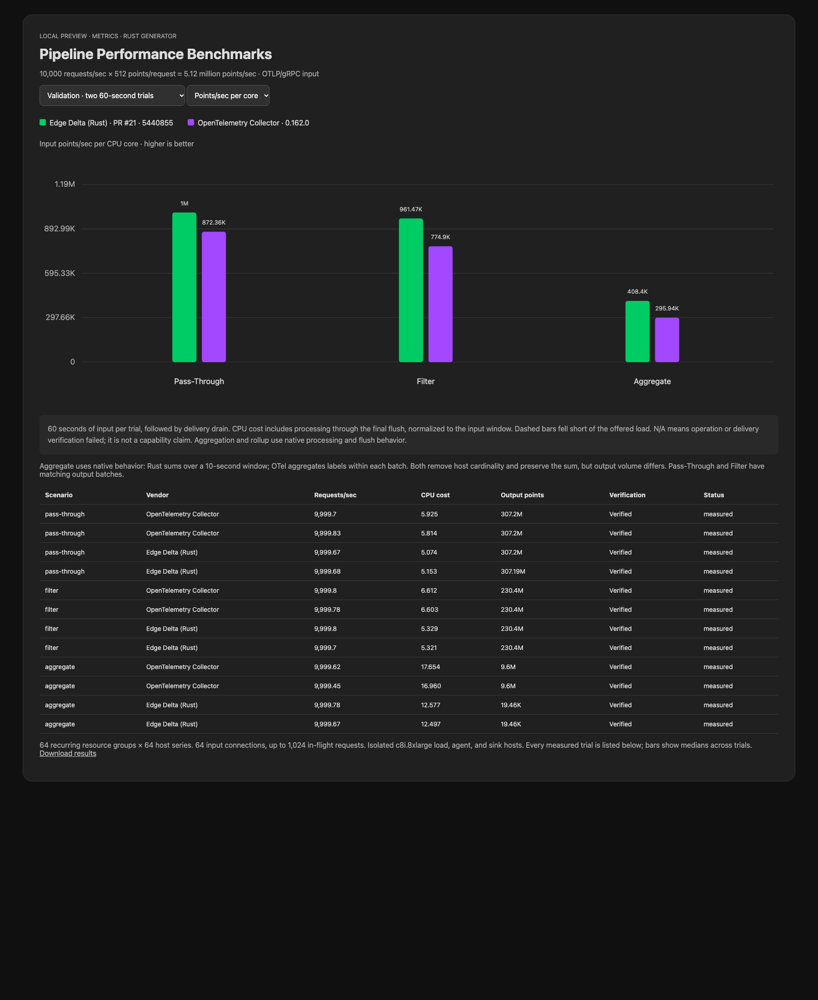

# Metric optimization comparison

[Interactive report](https://github.com/edgedelta/pipeline-performance-bench/blob/3efd3f6c749f2309a877632d40ab5c1792a85cef/previews/otlp/2026-10-16/metric-native/index.html) · [Raw results](results.json) · [Rust PR #21](https://github.com/edgedelta/red/pull/21)

10,000 requests/sec × 512 points/request (5.12 million points/sec), Rust generator and sink, isolated c8i.8xlarge hosts. All iterations used the same hosts and configuration. The final validation runs OTel before Rust, reversing the exploratory run order. The final candidate was validated with two 60-second trials per agent per scenario after three 30-second optimization iterations. All final cases sustained the target and passed operation and delivery verification.

Median CPU cost (total CPU through delivery divided by input-window duration; lower is better):

| Scenario | Rust | OTel 0.162.0 | Rust CPU reduction |
|---|---:|---:|---:|
| pass-through | 5.114 | 5.870 | 12.9% |
| filter | 5.325 | 6.607 | 19.4% |
| aggregate | 12.537 | 17.307 | 27.6% |

Pass-Through and Filter have matching output batch sizes and verified per-trial delivery. **Aggregate is a native-behavior comparison, not equal output work:** Rust aggregates over a 10-second window; OTel's metricstransform aggregate_labels reduces each incoming batch. Both remove host cardinality and preserve sums, but Rust sends fewer output points. Do not generalize that ranking to identical aggregation algorithms or output volumes.

## Configurations

| Scenario | Rust | OTel |
|---|---|---|
| pass-through | [YAML](https://github.com/edgedelta/pipeline-performance-bench/blob/3efd3f6c749f2309a877632d40ab5c1792a85cef/previews/otlp/2026-10-16/metric-native/validation/pass-through/red-512-10000-0.yaml) | [YAML](https://github.com/edgedelta/pipeline-performance-bench/blob/3efd3f6c749f2309a877632d40ab5c1792a85cef/previews/otlp/2026-10-16/metric-native/validation/pass-through/otelcol-512-10000-0.yaml) |
| filter | [YAML](https://github.com/edgedelta/pipeline-performance-bench/blob/3efd3f6c749f2309a877632d40ab5c1792a85cef/previews/otlp/2026-10-16/metric-native/validation/filter/red-512-10000-0.yaml) | [YAML](https://github.com/edgedelta/pipeline-performance-bench/blob/3efd3f6c749f2309a877632d40ab5c1792a85cef/previews/otlp/2026-10-16/metric-native/validation/filter/otelcol-512-10000-0.yaml) |
| aggregate | [YAML](https://github.com/edgedelta/pipeline-performance-bench/blob/3efd3f6c749f2309a877632d40ab5c1792a85cef/previews/otlp/2026-10-16/metric-native/validation/aggregate/red-512-10000-0.yaml) | [YAML](https://github.com/edgedelta/pipeline-performance-bench/blob/3efd3f6c749f2309a877632d40ab5c1792a85cef/previews/otlp/2026-10-16/metric-native/validation/aggregate/otelcol-512-10000-0.yaml) |

Input is OTLP/gRPC; output is uncompressed OTLP/HTTP protobuf. There is no batch processor. OTel's sending queue and retries are disabled; HTTP pools allow 1,024 connections. Rust retains its built-in delivery retry handling; successful trials report no RPC errors. The generator uses 64 connections and up to 1,024 in-flight requests. The fixture cycles through 64 resource groups and 64 host series. Each trial's calibration, warm-up and final drain evidence is retained in its scenario report.

## Changes and evidence

- `ac30601`: metric-native field-only OTTL evaluation, shared resource preservation, precompiled aggregation expressions, fewer OTLP input/output copies.
- `8523f81`: remove unconditional output-batch cloning used only for counter accounting; preserve success-only counters.
- `5440855`: serialize scalar metric string attributes directly into OTLP/HTTP protobuf; other shapes use the existing encoder. Golden tests compare decoded messages and exact wire bytes.

The first iteration's CPU profile (`profile-iteration1.txt`) identified allocation/freeing and batch copying as major costs. Profiling was a separate diagnostic run and was excluded from the scores.

Validation: 1,251 Rust library tests passed (one ignored), four delivery integration tests passed, and 11 benchmark harness tests passed (one skipped). Chart controls and rendering were checked. Release builds use `cargo zigbuild --release --locked --target x86_64-unknown-linux-gnu`; source revisions and measured binary hashes are recorded in results.json and checked against each raw report.

These are unreleased PR measurements. Rust PR #21 and benchmark PR #29 remain unmerged. The public Pages site is unchanged.

Full configs, fixtures, logs, profiles and generated previews are preserved in the [evidence archive](https://github.com/edgedelta/pipeline-performance-bench/releases/tag/untagged-7559f9a28ba799f80881) and the linked immutable source snapshot.
