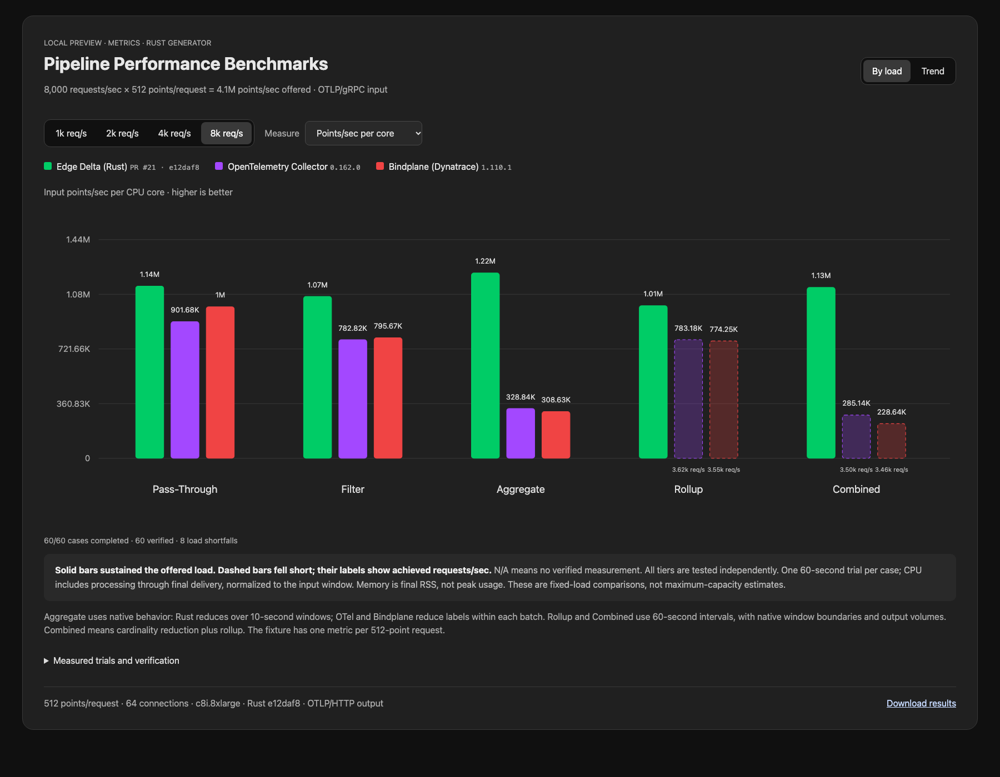
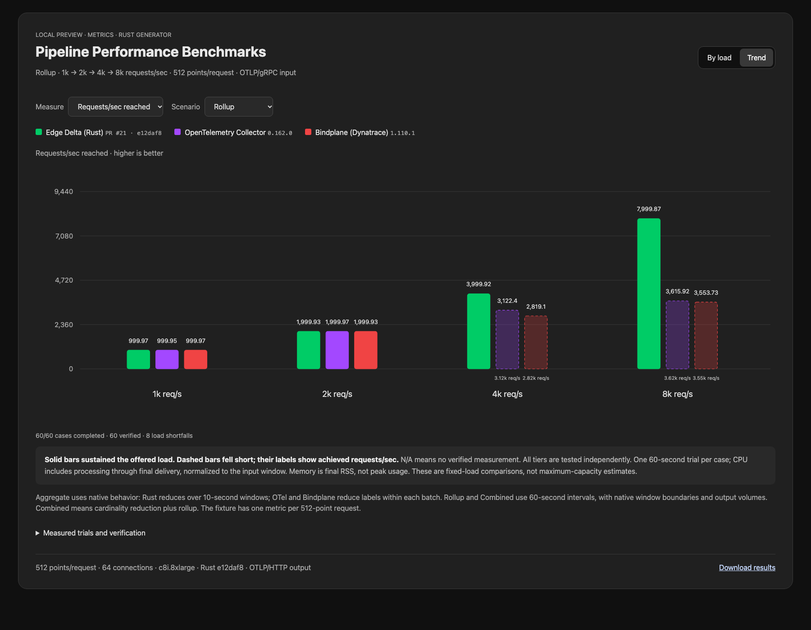

# Metric request-rate ladder

[Interactive chart](https://github.com/edgedelta/pipeline-performance-bench/blob/3efd3f6c749f2309a877632d40ab5c1792a85cef/previews/otlp/2026-10-17/metrics-ladder/index.html) · [Raw measurements](results.json)

The ladder covers **Pass-Through, Filter, Aggregate, Rollup and Combined** at **1,000, 2,000, 4,000 and 8,000 requests/sec**, with **512 points/request**. Enrich is excluded. Rust e12daf8, OTel Collector 0.162.0 and Bindplane 1.110.1 use the same isolated agent host; Rust load generator and sink run on separate c8i.8xlarge hosts. All tiers are measured independently, even after a lower-tier shortfall. OTLP/gRPC input, uncompressed OTLP/HTTP output, 64 connections, up to 1,024 in-flight requests, 64 recurring resource groups and 64 host series. Source commit and binary hashes are recorded in source.json and each raw measurement.

One 60-second trial per case, 60 cases total. All 20 calibrations passed. All 60 cases passed operation and delivery checks with zero RPC errors or rejected points. Status counts: {'measured': 52, 'input_shortfall': 8}. Small differences require repeat trials; these results are not a maximum-capacity search.

## Highest tested tier sustained

This is the highest offered tier that passed in this run, not a capacity limit. A passing tier requires at least 95% of the offered rate, no RPC errors/rejections, and verified output. The chart shows achieved rates and marks shortfalls with dashed bars.

| Scenario | Rust req/s | OTel req/s | Bindplane req/s |
|---|---:|---:|---:|
| pass-through | 8,000 | 8,000 | 8,000 |
| filter | 8,000 | 8,000 | 8,000 |
| aggregate | 8,000 | 8,000 | 8,000 |
| rollup | 8,000 | 2,000 | 2,000 |
| combined | 8,000 | 2,000 | 2,000 |

## CPU cost

CPU seconds through final delivery divided by input-window duration; lower is better. † indicates a load shortfall, so low CPU does not represent processing the full offered input. Memory in the chart is final RSS, not peak/average memory. Efficiency uses the achieved rate.

| Scenario | Offered req/s | Rust CPU | OTel CPU | Bindplane CPU |
|---|---:|---:|---:|---:|
| pass-through | 1,000 | 0.327 | 0.633 | 0.631 |
| pass-through | 2,000 | 0.803 | 1.181 | 1.180 |
| pass-through | 4,000 | 1.799 | 2.255 | 2.249 |
| pass-through | 8,000 | 3.604 | 4.543 | 4.095 |
| filter | 1,000 | 0.359 | 0.673 | 0.680 |
| filter | 2,000 | 0.860 | 1.279 | 1.275 |
| filter | 4,000 | 1.888 | 2.507 | 2.447 |
| filter | 8,000 | 3.835 | 5.232 | 5.148 |
| aggregate | 1,000 | 0.389 | 1.530 | 1.549 |
| aggregate | 2,000 | 0.799 | 3.053 | 3.077 |
| aggregate | 4,000 | 1.672 | 6.357 | 6.564 |
| aggregate | 8,000 | 3.349 | 12.455 | 13.271 |
| rollup | 1,000 | 0.423 | 0.648 | 0.637 |
| rollup | 2,000 | 0.906 | 1.223 | 1.235 |
| rollup | 4,000 | 1.900 | 2.048 † | 1.928 † |
| rollup | 8,000 | 4.066 | 2.364 † | 2.350 † |
| combined | 1,000 | 0.376 | 1.539 | 1.555 |
| combined | 2,000 | 0.788 | 3.123 | 3.173 |
| combined | 4,000 | 1.690 | 5.800 † | 7.614 † |
| combined | 8,000 | 3.632 | 6.292 † | 7.757 † |

## Achieved request rates

| Scenario | Offered req/s | Rust req/s | OTel req/s | Bindplane req/s |
|---|---:|---:|---:|---:|
| pass-through | 1,000 | 1,000.0 | 1,000.0 | 1,000.0 |
| pass-through | 2,000 | 1,999.9 | 2,000.0 | 2,000.0 |
| pass-through | 4,000 | 3,999.9 | 3,999.9 | 3,999.9 |
| pass-through | 8,000 | 7,999.8 | 7,999.9 | 7,999.9 |
| filter | 1,000 | 1,000.0 | 1,000.0 | 1,000.0 |
| filter | 2,000 | 1,999.9 | 1,999.9 | 2,000.0 |
| filter | 4,000 | 3,999.9 | 3,999.9 | 3,999.9 |
| filter | 8,000 | 7,999.9 | 7,999.8 | 7,999.9 |
| aggregate | 1,000 | 1,000.0 | 1,000.0 | 1,000.0 |
| aggregate | 2,000 | 2,000.0 | 1,999.9 | 1,999.9 |
| aggregate | 4,000 | 3,999.9 | 3,999.9 | 3,999.8 |
| aggregate | 8,000 | 7,999.7 | 7,999.4 | 7,999.7 |
| rollup | 1,000 | 1,000.0 | 1,000.0 | 1,000.0 |
| rollup | 2,000 | 1,999.9 | 2,000.0 | 1,999.9 |
| rollup | 4,000 | 3,999.9 | 3,122.4 | 2,819.1 |
| rollup | 8,000 | 7,999.9 | 3,615.9 | 3,553.7 |
| combined | 1,000 | 1,000.0 | 1,000.0 | 1,000.0 |
| combined | 2,000 | 2,000.0 | 1,999.9 | 2,000.0 |
| combined | 4,000 | 3,999.9 | 3,293.3 | 3,705.9 |
| combined | 8,000 | 7,999.9 | 3,504.2 | 3,463.8 |

## Interpretation and verification

Pass-Through preserves 512 output points/request; Filter removes health-route points and verifies 384 output points/request. Aggregate reduces host cardinality; Rust sums over 10-second windows while collectors reduce labels within each batch. Rollup retains host labels with a 60-second interval. Combined combines cardinality reduction and a 60-second interval. Native window boundaries and output volumes differ; these are not equal-output-work aggregation comparisons. Stateful cases start fresh without warm-up and include final delivery flush in CPU cost. The fixture contains one metric with 512 points per request; mixed-metadata correctness is covered separately, not throughput-tested here.

Every raw scenario directory contains configuration YAML, protobuf fixtures, calibration, versions, hashes, resource measurements and delivery counters. The reusable renderer rejects missing/duplicate cases and mismatched Rust hashes; its unit tests and all chart control combinations were checked. Rust is a development build identified by its source commit and binary hash.

The 60-second generator runs have measured input windows of 61.507–65.732 seconds including SSH control overhead, following the existing harness normalization. All seven cloud resources were destroyed and Terraform state contains no resources.

Full configs, fixtures, logs, profiles and generated previews are preserved in the [evidence archive](https://github.com/edgedelta/pipeline-performance-bench/releases/tag/untagged-7559f9a28ba799f80881) and the linked immutable source snapshot.
