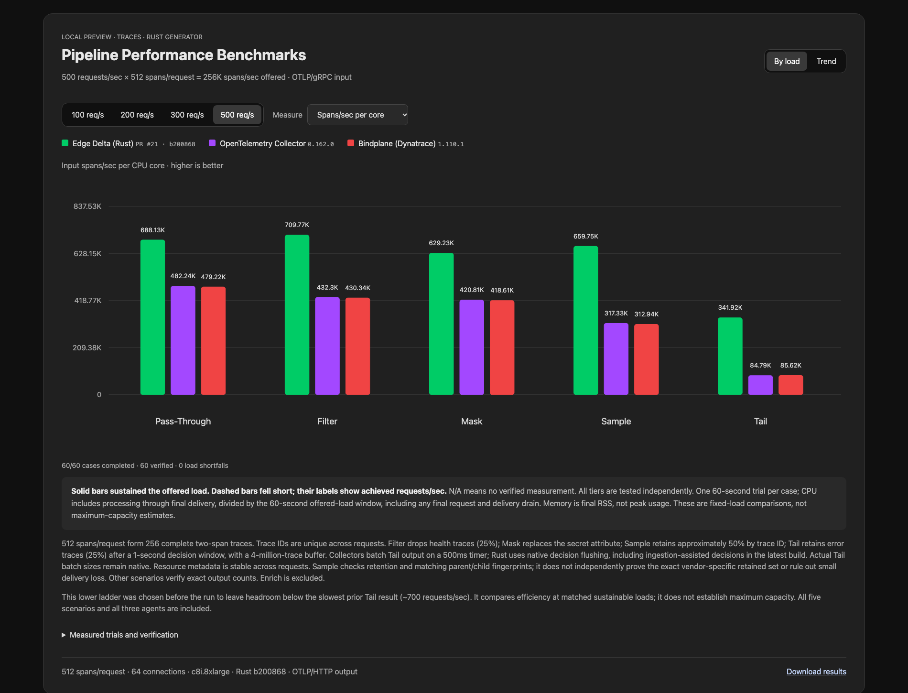

# Full trace comparison at lower loads

[Interactive chart](https://github.com/edgedelta/pipeline-performance-bench/blob/3efd3f6c749f2309a877632d40ab5c1792a85cef/previews/otlp/2026-10-18/traces-low/index.html) · [Raw results](results.json) · [Previous high-load comparison](https://github.com/edgedelta/pipeline-performance-bench/blob/3efd3f6c749f2309a877632d40ab5c1792a85cef/previews/otlp/2026-10-17/mask-tail-optimization/README.md)

The ladder **100 / 200 / 300 / 500 requests/sec**, with **512 spans/request**, was selected before measuring this run. The 500 req/sec ceiling leaves roughly 30% headroom below the slowest prior Tail result (~708 req/sec). The same ladder applies to Pass-Through, Filter, Mask, Sample and Tail for all three agents. This compares efficiency at matched sustainable loads, not maximum throughput, and does not establish an advantage at every possible load. All attempted cases and prior high-load results are retained.

One 60-second trial per case; 60 cases attempted. Rust `b200868`, OTel Collector 0.162.0 and Bindplane 1.110.1 run sequentially on the same isolated c8i.8xlarge agent host, with separate c8i.8xlarge generator and sink hosts. OTLP/gRPC input and uncompressed OTLP/HTTP output; 64 connections, 1,024 in-flight requests and a 30-second request timeout. The Rust binary is the same one used in the prior high-load retest.

Status counts: {'measured': 60}. 60/60 cases passed their scenario checks. 20/20 direct-to-sink calibrations passed. Sampling checks are statistical, as described below.

Rust used less CPU than both collectors in all 20 matched scenario/load comparisons in this run. At 500 req/sec, Rust used approximately 30% less CPU for Pass-Through, 39% for Filter, 33% for Mask, 52–53% for Sample and 75% for Tail. These are single-trial observations.

## CPU at the 500 req/sec tier

Total CPU seconds through final delivery divided by the 60-second offered-load window. Lower is better. A dash means no verified measurement; † indicates a load shortfall.

| Scenario | Rust cores | OTel cores | Bindplane cores |
|---|---:|---:|---:|
| pass-through | 0.372 | 0.531 | 0.534 |
| filter | 0.361 | 0.592 | 0.595 |
| mask | 0.407 | 0.608 | 0.611 |
| sample | 0.388 | 0.807 | 0.818 |
| tail | 0.749 | 3.019 | 2.990 |

## All measured tiers

| Scenario | Offered req/s | Rust cores | OTel cores | Bindplane cores |
|---|---:|---:|---:|---:|
| pass-through | 100 | 0.079 | 0.115 | 0.118 |
| pass-through | 200 | 0.153 | 0.227 | 0.228 |
| pass-through | 300 | 0.216 | 0.328 | 0.337 |
| pass-through | 500 | 0.372 | 0.531 | 0.534 |
| filter | 100 | 0.076 | 0.119 | 0.119 |
| filter | 200 | 0.144 | 0.229 | 0.233 |
| filter | 300 | 0.205 | 0.350 | 0.350 |
| filter | 500 | 0.361 | 0.592 | 0.595 |
| mask | 100 | 0.090 | 0.134 | 0.135 |
| mask | 200 | 0.167 | 0.255 | 0.260 |
| mask | 300 | 0.240 | 0.378 | 0.384 |
| mask | 500 | 0.407 | 0.608 | 0.611 |
| sample | 100 | 0.085 | 0.173 | 0.176 |
| sample | 200 | 0.162 | 0.340 | 0.340 |
| sample | 300 | 0.237 | 0.499 | 0.501 |
| sample | 500 | 0.388 | 0.807 | 0.818 |
| tail | 100 | 0.139 | 0.525 | 0.509 |
| tail | 200 | 0.273 | 1.119 | 1.090 |
| tail | 300 | 0.430 | 1.765 | 1.722 |
| tail | 500 | 0.749 | 3.019 | 2.990 |

## Method and limits

A passing case sustains at least 95% of offered load with no RPC errors/rejections and passes its scenario checks. All tiers are attempted independently. There is one trial per case; small differences need repeat trials. Low-load efficiency includes fixed runtime costs and does not predict saturation performance. Memory is final RSS, not peak memory.

Each request has 256 complete two-span traces, unique IDs across requests, stable resource metadata, a 20 ms duration, and one event and link per span. Parent and child arrive together. This does not test delayed/distributed span arrival, arbitrary payload sizes or mixed resource metadata.

Filter drops health traces (25%). Mask replaces the secret attribute with REDACTED. Sample uses each vendor’s native 50% trace-ID sampler. Tail keeps error traces (25%) after a 1-second decision window; all agents have four-million-trace buffers. Collectors batch Tail exports on a 500 ms timer, with a one-million-span cap. Rust uses native bounded flushing and ingestion-assisted decisions. Actual Tail batch sizes remain native. Pass-Through/Mask preserve 512-span output batches; Filter preserves 384-span batches, verified at the sink.

The sink verifies payload fields, parent/child counts and matching trace-ID fingerprints. Pass-Through, Filter, Mask and Tail require exact retained-span counts. Sample checks 45–55% retention and intact paired spans; it does not independently prove the exact vendor-specific retained set or exclude small delivery loss. Invalid measurements are not scored as efficiency results.

Tail starts with a fresh agent without warm-up. Other scenarios have a five-second warm-up excluded from measurements. CPU includes processing through final delivery, normalized to the offered-load window. Raw counters named points count spans for these trace runs.

Rust is a development build identified by its source commit and binary hash.

Temporary benchmark infrastructure was destroyed after completion: seven resources removed, zero resources remaining in Terraform state.

Full configs, fixtures, logs, profiles and generated previews are preserved in the [evidence archive](https://github.com/edgedelta/pipeline-performance-bench/releases/tag/untagged-7559f9a28ba799f80881) and the linked immutable source snapshot.
