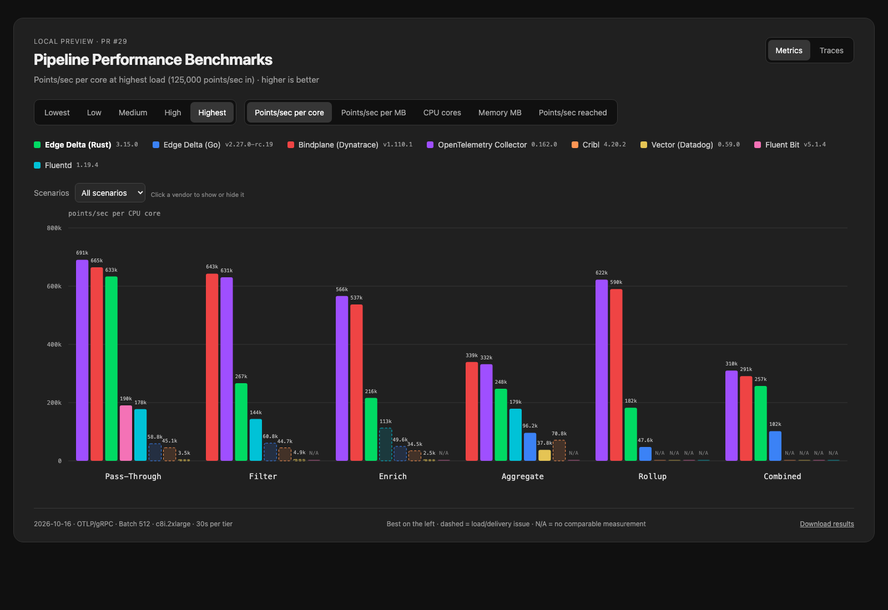
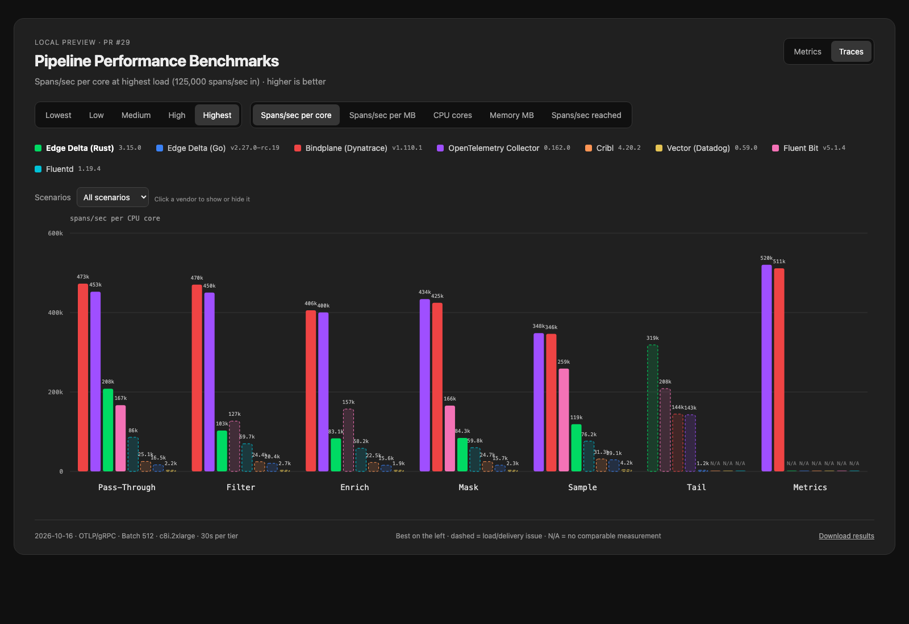

# Metrics & traces — full load-tier run

[Open the standalone chart](index.html) (download and open locally). The local preview is served at http://127.0.0.1:8765/ while its server is running.

Metrics and Traces tabs, five load tiers, per-core/per-MB efficiency, CPU, memory, and reached input rates. Vendor toggles and scenario selection let you focus the comparison. Solid and dashed bars distinguish sustained results from load/delivery issues. N/A means no comparable measurement for the tested configuration.

[Methodology](methodology.md) · [JSON results](data) · [Raw evidence](evidence.tar.gz)

Results were measured from the unmerged PR checkout on isolated c8i.2xlarge instances. Signal/scenario shards use the same workload and host class; every row records its source commit, binary hash and version. Raw captures preserve metadata differences without treating them as forwarding failures. All five load tiers were attempted for each configuration that passed its operation check.

The public log benchmark URL is unchanged. This report is a local/PR preview; nothing has been merged or published to Pages.

