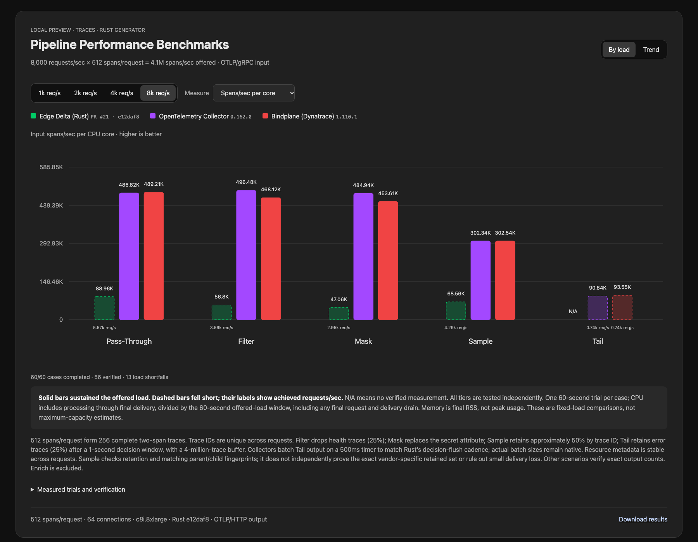
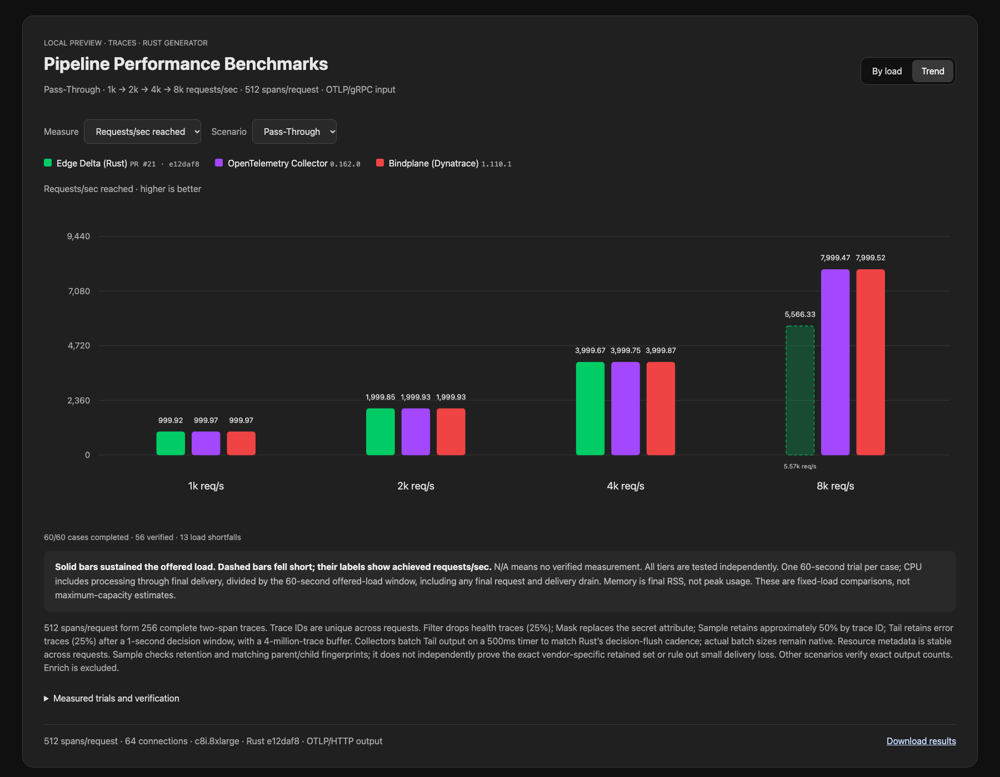

# Trace request-rate ladder

[Interactive chart](index.html) · [Raw results](results.json) · [Metrics ladder](../metrics-ladder/index.html)

Pass-Through, Filter, Mask, Sample and Tail at **1k / 2k / 4k / 8k requests/sec**, with **512 spans/request**. One 60-second trial per case; 60 cases attempted. Rust e12daf8, OTel Collector 0.162.0 and Bindplane 1.110.1 run sequentially on the same isolated c8i.8xlarge agent host. Rust load generator and sink have separate c8i.8xlarge hosts. OTLP/gRPC input and uncompressed OTLP/HTTP output; 64 connections, 1,024 in-flight requests and 30-second request timeout. Exact source and binary provenance is in source.json and raw results.

Status counts: {'measured': 43, 'input_shortfall': 13, 'operation_mismatch': 4}. 56/60 cases passed their scenario checks. 20/20 direct-to-sink calibrations passed. Sampling checks are statistical, as described below.

## Highest tested passing tier

A passing case sustains at least 95% of offered load with no RPC errors/rejections and passes its scenario checks. These are tested tiers, not maximum capacity estimates. A dash means no tier passed all checks.

| Scenario | Rust req/s | OTel req/s | Bindplane req/s |
|---|---:|---:|---:|
| pass-through | 4,000 | 8,000 | 8,000 |
| filter | 4,000 | 8,000 | 8,000 |
| mask | 2,000 | 8,000 | 8,000 |
| sample | 4,000 | 8,000 | 8,000 |
| tail | — | — | — |

## Verified CPU measurements

Total CPU seconds through final delivery divided by the configured 60-second offered-load window. Unlike wall-clock normalization, this includes the cost of requests completing after the load window without inflating efficiency. † denotes an input shortfall; lower CPU does not imply handling the full target. A dash means no verified measurement. Memory in the chart is final RSS, not peak memory.

| Scenario | Offered req/s | Rust cores | OTel cores | Bindplane cores |
|---|---:|---:|---:|---:|
| pass-through | 1,000 | 2.616 | 1.031 | 1.045 |
| pass-through | 2,000 | 5.511 | 1.992 | 2.029 |
| pass-through | 4,000 | 12.135 | 3.958 | 4.012 |
| pass-through | 8,000 | 32.037 † | 8.413 | 8.372 |
| filter | 1,000 | 4.978 | 1.041 | 1.054 |
| filter | 2,000 | 10.213 | 2.058 | 2.065 |
| filter | 4,000 | 28.841 | 4.124 | 4.141 |
| filter | 8,000 | 32.081 † | 8.250 | 8.750 |
| mask | 1,000 | 5.670 | 1.065 | 1.072 |
| mask | 2,000 | 11.957 | 2.098 | 2.102 |
| mask | 4,000 | 32.094 † | 4.256 | 4.279 |
| mask | 8,000 | 32.100 † | 8.446 | 9.030 |
| sample | 1,000 | 4.137 | 1.443 | 1.460 |
| sample | 2,000 | 8.499 | 2.946 | 2.956 |
| sample | 4,000 | 21.802 | 6.027 | 6.096 |
| sample | 8,000 | 32.062 † | 13.547 | 13.538 |
| tail | 1,000 | — | 3.980 † | 4.053 † |
| tail | 2,000 | — | 4.119 † | 3.840 † |
| tail | 4,000 | — | 3.964 † | 4.111 † |
| tail | 8,000 | — | 4.184 † | 4.033 † |

## Tail delivery audit

Rust Tail cases with failed exact-count verification are excluded from efficiency scores. The deficit is retained spans expected from acknowledged input minus spans received after the final drain.

| Offered req/s | Expected retained spans | Delivered spans | Missing spans |
|---|---:|---:|---:|
| 1,000 | 3,285,120 | 3,285,066 | 54 |
| 2,000 | 3,254,784 | 3,254,700 | 84 |
| 4,000 | 3,121,024 | 3,120,946 | 78 |
| 8,000 | 3,269,120 | 3,269,044 | 76 |

Raw traffic counters retain the generic field name `points`; for the traces signal these count spans.

## Method and limitations

Each request contains 256 complete two-span traces, with unique IDs across requests, stable resource metadata, a 20ms duration, one event and one link per span. Parent and child arrive in the same request; this does not test delayed or distributed span arrival.

Filter drops health traces (25%). Mask replaces the secret attribute with REDACTED. Sample uses each vendor’s native 50% trace-ID sampler. Tail keeps error traces (25%) after a 1-second decision window. Tail buffers allow four million traces in each agent. Collectors batch Tail exports on a 500ms timer, matching Rust’s decision-check cadence; actual batch sizes remain native. A one-million-span collector cap and 256MiB sink request limit bound exports. Pass-Through/Mask preserve 512-span batches and Filter preserves 384-span batches, verified at the sink. Sample batch sizes follow native selections.

The sink verifies payload fields, parent/child counts and matching trace-ID fingerprints. Pass-Through, Filter, Mask and Tail also require exact retained-span counts. Sample checks 45–55% retention and intact paired spans; it does not independently verify the vendor-specific retained set or rule out small delivery loss. `sampling_verified` is separate from `delivery_verified`. Invalid delivery is not scored as an efficiency result.

Tail starts with a fresh agent without warm-up. Other scenarios receive a five-second warm-up, whose results are excluded. All offered tiers are attempted independently. Small differences require repeat trials. This fixture does not measure arbitrary span sizes, mixed resource metadata, or maximum capacity.

The prior metric report remains unchanged. Both PRs remain draft/unmerged and the public Pages site is unchanged.

All seven benchmark cloud resources were destroyed; Terraform state contains no resources.

